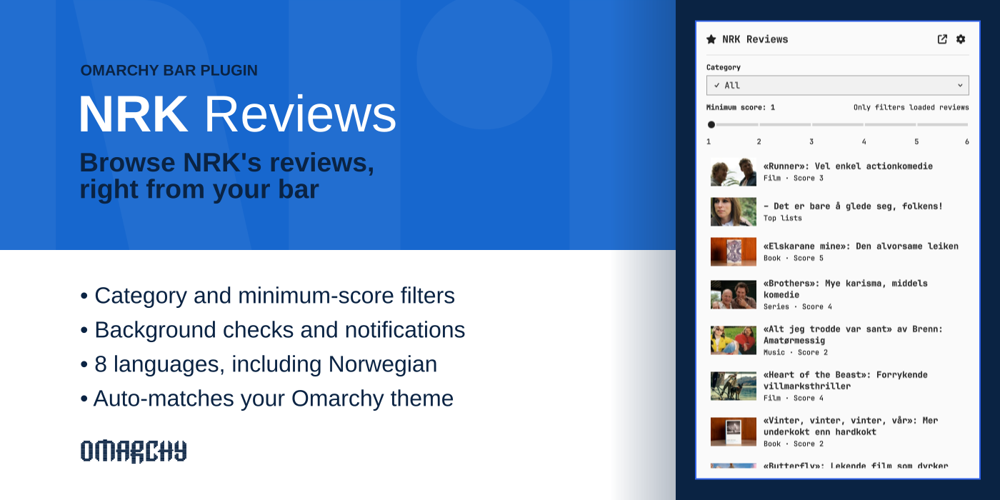
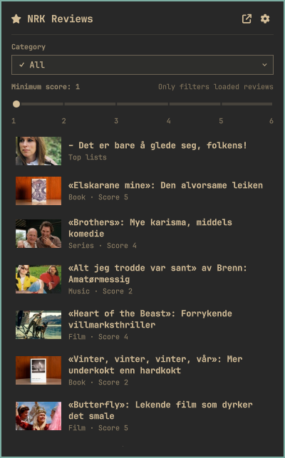
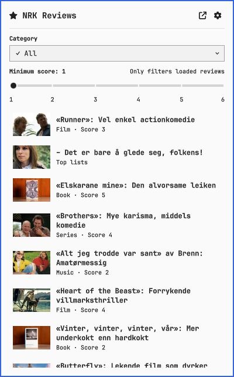
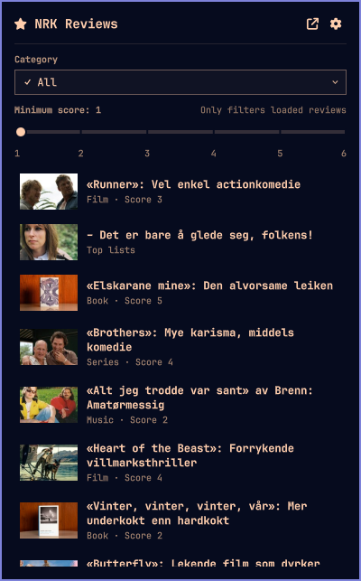

# NRK Anmeldelser (NRK Reviews)

Browse [NRK's reviews](https://www.nrk.no/anmeldelser) — film, series, TV,
music, performing arts, books, games, art, architecture, and comedy — from
the [Omarchy](https://omarchy.org/) bar, with the same category filter as
the site itself.

[](preview.png)

| Action | Effect |
|---|---|
| Left click a review | Open it on nrk.no in your browser |
| Right click a review | Copy its URL to the clipboard |
| Category dropdown | Filter to one of NRK's review categories |
| Minimum-score slider | Hide reviews below the picked score |
| "Load more" | Fetch the next page of reviews |
| ↗ (top right) | Open nrk.no/anmeldelser directly in your browser |
| ⚙ (top right) | Swap the list for the settings view |
| <kbd>Esc</kbd> | Close the panel |

The settings view holds a language override, background-refresh
controls, and a link to this plugin's GitHub page.

## Install

Requires Omarchy 4 or later (the plugin system this relies on isn't
available in earlier versions).

```bash
omarchy plugin add https://github.com/andersdosen/omarchy-nrkreviews.git --enable
```

You'll be prompted to pick a bar section (left/center/right) for the icon.

## How it works

Reviews come from NRK's own `autonomous-content/plugs.json` endpoint —
the same one that backs "load more" and the category filter on
nrk.no/anmeldelser. It's unofficial, so NRK could change or remove it
without notice.

The category dropdown mirrors NRK's own grouping (e.g. "Film & series"
covers both film and series, "Performing arts" covers musicals, opera,
theatre, and dance). The minimum-score slider is local-only — NRK's API
doesn't support score filtering server-side — so it filters whatever
page(s) you've already loaded, and hides itself under "Top lists" and
"Architecture" since those are mostly unscored content.

## Language

By default ("System" in the settings view), the UI follows your system
language automatically (via `Qt.locale()`), falling back to Norwegian
Bokmål (`nb`) rather than English, since NRK is a Norwegian broadcaster
and most of the reviewed content is itself in Norwegian. English (`en`),
Swedish (`sv`), German (`de`), Danish (`da`), Finnish (`fi`), Spanish
(`es`), and Italian (`it`) are the translations on top of that; any
string not yet translated in your language falls back to `nb`. To add a
language, add a `languages.<code>` entry to [`Strings.js`](Strings.js)
with the same keys as `nb`, and a matching entry in `languageNames` so
it shows up in the picker — see the comments at the top of that file.
Pull requests adding new languages are welcome.

The settings view's "Language" dropdown overrides system-language
detection with a specific choice instead — Norwegian first, then
English, then the rest alphabetically by each language's own native
name. It takes effect immediately and persists across restarts.

## Theming

Colors, fonts, and spacing all follow your active Omarchy theme — the
panel reads the same bar foreground color, accent, and font as the rest
of the shell, so it re-themes automatically when you switch themes, no
restart needed. Same panel, three themes:

<table>
<tr>
<td align="center"><a href="docs/preview-gruvbox.png"></a><br>Gruvbox</td>
<td align="center"><a href="docs/preview-lupine.png"></a><br>Lupine</td>
<td align="center"><a href="docs/preview-ethereal.png"></a><br>Ethereal</td>
</tr>
</table>

## New-review indicator

A background check (on by default, every 20 minutes — configurable in
settings) marks the bar icon with a small dot when a new review is
published, and sends a desktop notification naming it unless you've
turned that off. Clicking the notification opens the review; opening
the panel clears the dot.

## Data & privacy

- Review listings come from `www.nrk.no/komponenter/api/autonomous-content/plugs.json`,
  fetched both when you open the panel and by the periodic background check.
- Thumbnails load from NRK's own image CDN (`gfx.nrk.no`), resized to a
  small size, and are cached to disk under
  `$XDG_CACHE_HOME/omarchy-nrkreviews/thumbs/` (`~/.cache/...` if unset)
  so browsing the same list twice doesn't re-fetch them.
- Opening a review uses your default browser (`omarchy-launch-browser`);
  copying a link uses `wl-copy`; new-review notifications use
  `omarchy-notification-send`.

## Disclaimer

This is an independent, unofficial client for NRK's public review
listings and is not affiliated with, endorsed by, or sponsored by NRK
(Norsk rikskringkasting) in any way. All review content, images, titles,
and the NRK name and logo belong to NRK — this plugin only displays
publicly available data from nrk.no and claims no ownership over any of
it.

## Uninstall

```bash
omarchy plugin remove andersdosen.nrkreviews
```

## License

MIT — see [LICENSE](LICENSE). The MIT license covers this plugin's own
code only, not NRK's content, trademarks, or branding (see Disclaimer
above).
